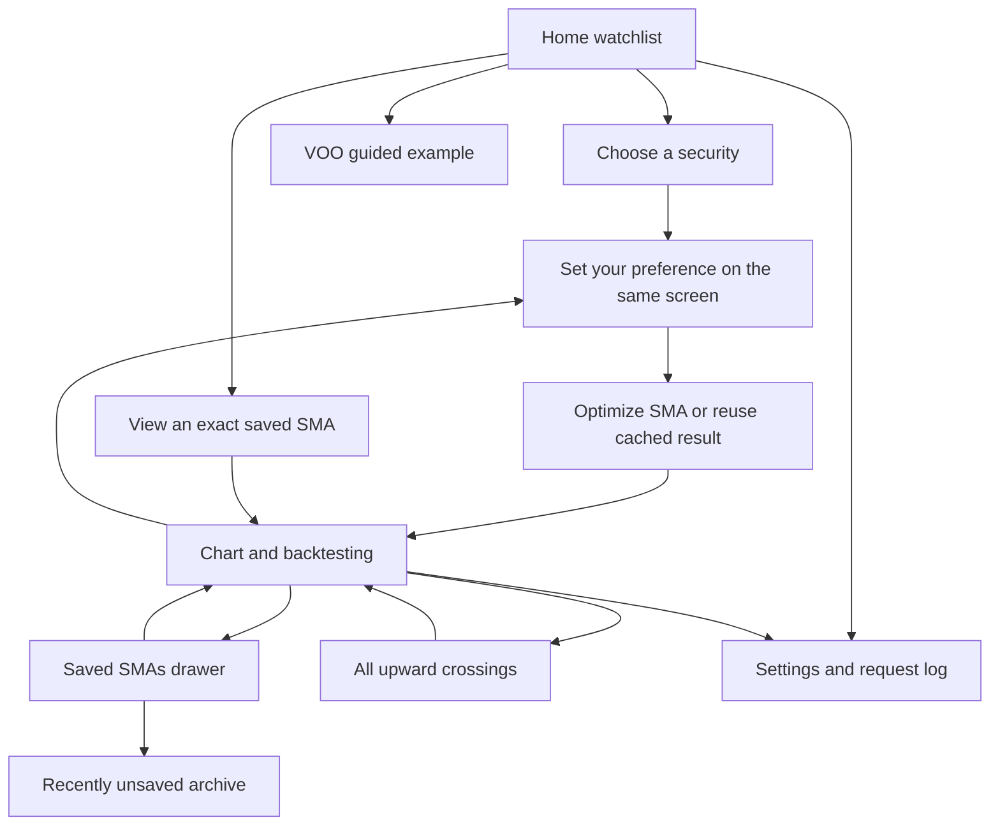

# Current app behaviour and calculation rules

Current source: **0.18.0**. Android and desktop are active. Native iPhone
releases are paused; [the Vercel/PWA app supports local Python and configurable Web Push](docs/PRIVATE_IPHONE_INSTALLATION.md).
This document describes the current app, including its material limitations.

Android distribution uses an explicitly signed release variant. CI verifies the
final APK's certificate, release flags, permissions and component protections.
Version 0.13.8 fixes certificate parsing for Android SDK Build Tools 37;
0.13.7 compiled successfully but failed this verification step before upload.
Automatic Android cloud/full backups are disabled for private application data.
The [package security audit](docs/ANDROID_PACKAGE_SECURITY.md) records the earlier
signing mismatch and the reported Play Protect warning, which still requires
device/Google verification. Earlier APKs with different signers cannot promise
in-place upgrades to the retained key.

## Data and persistence

Search accepts partial ticker/company names and runs on Enter or Submit only.
Selecting a supported US/SG stock or ETF loads all available completed daily
history. All SMAs for a security share that history. Desktop uses an isolated
yfinance helper; Android uses the portable HTTPS search/chart adapter.

Analysis uses **Adj Close**, including dividend and split adjustments. Ordinary
Close and corporate actions are retained for validation/resynchronization.
Missing adjustments never silently fall back to unadjusted Close. A failed
refresh retains usable prior data and reports its freshness.

Search results, prices, saved periods, names, colours, visibility, alert
preferences, archive entries and request logs survive a normal restart.
Explicitly clearing downloaded data keeps saved SMA parameters. Removing the
app or clearing Android app storage can remove all of its local data. There is
no cross-device/cloud synchronization in the current native app.

[Market-data behaviour](docs/MARKET_DATA.md) and
[desktop testing](docs/YAHOO_DESKTOP_TESTING.md) describe request/cache limits.

## Frequency and crossing rules

An SMA is the arithmetic mean of X valid trading observations. The engine
searches eligible integer periods with a history-dependent cap and the existing
coverage/gap exclusions; it minimizes the error from the target annual rate.
Exact arithmetic resolves frequency ties, with the shorter period preferred.

For live data:

```text
observed annual frequency = crossings × 365 / observable calendar days
```

Observable time sums elapsed days between adjacent usable price/SMA points.
Warm-up and broken intervals are excluded. Weekends/holidays between valid
closes count. A target of X/year is the closest historical annualized average,
not exactly X events in every January–December year or a forecast.

Upward crossings follow below/equal/above rules, resetting across gaps. Their
markers and scenario-a entries use the intersection of daily price/SMA line
segments, attributed to the confirming session. They are not live tick data or
proof of an achievable intraday fill. [Calendar policy](docs/CALENDAR_YEAR_FREQUENCY.md).

Live 1Y/3Y/5Y and custom-year horizons use 365 days per year; month presets use
calendar months. Date-free offline reference fixtures retain their 252-session
approximation. The period cap still measures history in trading observations;
it does not redefine a live calendar year.

## Navigation and chart controls



Library lists real saved securities; none is selected at live startup. Company
accordions start collapsed each launch and share expansion state during the
session. Saving, restoring, naming, colouring and hiding lines retain their
identities. Viewing a saved SMA opens its exact period without retuning it.
Hidden lines can still alert when enabled. The archive keeps ten recent unsaves.

Home, Charts, Alerts and Settings are persistent bottom tabs. The chart's magnifier-plus starts a new security
selection. Back dismisses the keyboard/sheets before traversing pages and exits
only from Library. The guided example uses **Vanguard S&P 500 ETF (VOO)**,
initially 4/year and Max, independently of the selected security.

Charts use 3M/6M/9M/1Y/3Y/5Y/Max presets (unavailable longer ranges are omitted).
One-finger movement inspects the nearest visible EOD point. Two fingers pinch
continuously; lifting one ends the gesture without an extra jump. Zoom out or
reselecting the preset restores its base range. Chart zoom does not change the
optimization objective or investment horizon.

Below the company logo/name, the first and last finite adjusted closes inside
the visible bounds define the currency and percentage change. Both arrows and
values are green/up or red/down; flat/empty states are neutral. A preset says
PAST 3M/etc, and pinch displays actual endpoint dates. No interpolation or
network request is needed for this comparison.

## Backtesting

The independent horizon selector offers 1Y/3Y/5Y/Max and Custom years.
Each scenario contributes USD 100 per purchase and holds fractional units to
the final eligible close. These are price-ratio comparisons; no historical FX
conversion is performed for SGD quotes.

| Scenario | Entries |
| --- | --- |
| a. At N upward crossings | Interpolated crossing prices within the chosen horizon. |
| b. At N equal periods | DCA at the start of each of N equal calendar intervals; N=1 uses the start. Missing targets advance to eligible closes with distinct dates. |
| c. At N random points | 500 reproducible samples of N distinct eligible EOD dates. |

Random sample arithmetic mean purchase prices are rounded to the nearest whole
dollar, half up. The most frequent dollar group wins; ties prefer the group
nearest the overall median and then the lower dollar. The displayed result is
an actual sample nearest the winning dollar, with seed order breaking ties.
Its ending value uses each individual purchase price, not a budget divided by
an arithmetic average price.

The panel shows total contributed and ending values, a's growth relative to
contributions, and b/c ending-value differences versus a. Zero/undefined cases
are labelled appropriately. The footer ranks a against the 500 random samples
by the fraction with a **strictly higher arithmetic average purchase price**;
this is not an ending-return percentile. Fees, taxes, slippage and currency
movements are excluded; dividends are not added twice.

## Notifications and diagnostics

There are three phone types: Buy signal, Impending buy signal (End of trading)
and Impending buy signal (Start of trading). Each saved line has a phone switch
and its own switch for every type; Settings holds a master switch per type, and
all three must be On for a line to receive that type. All types and newly saved
line switches default On while existing stored Off choices remain Off. Actual OS
permission, channel settings, Focus/Do Not Disturb and scheduling policy still
control presentation and execution.

[The notification guide](docs/ANDROID_DAILY_NOTIFICATIONS.md) defines the four
SGT jobs, stale/holiday handling, duplicate suppression and tests. Desktop runs
interactive data requests only. The iPhone web app uses Supabase scheduling and Vercel Web Push after the owner
completes setup; browser timers cannot preserve native background work.

The copyable request log separates logical APP operations, actual HTTP calls,
CACHE hits and notification checks/triggers/delivery outcomes. Tokens, cookies,
raw response bodies and private paths are excluded. An OS/push acceptance
record is not proof that a user saw a banner.

Legacy email market-alert delivery and Google authorization remain removed. Optional release-update signup is separate and hidden until the server is configured. Legacy SQLite email
columns/preferences remain solely for upgrade compatibility; old email events
cannot be dispatched. [Validation status](docs/ANDROID_TEST_STATUS.md).

## iPhone local web runtime (0.15.0)

The web app now uses the shared pure Python engine/backtest modules inside a
Pyodide/NumPy browser worker. IndexedDB retains parameters, histories and settings;
Cancel terminates the calculation worker. Sign-out preserves local saved lines.
Vercel handles authenticated market requests and Web Push. Supabase stores only
synced alert parameters/subscriptions, required closing snapshots, and delivery
journals. pg_cron invokes the four shared SGT schedules; event/run claims prevent
replays. Per-line and global flags both apply, and chart visibility is independent.
Opening checks use a verified closing snapshot, with no intraday retrieval.

The [free setup guide](docs/PRIVATE_IPHONE_INSTALLATION.md) explains the seven
variables, SQL and physical iPhone acceptance checks. Existing Python-worker mode
remains available when both old worker variables are set. The native Android
engine and scheduler are unchanged by the web implementation.


## Optional release-update signup (0.17.0)

The first-open welcome page and Settings editor are enabled after Vercel confirms
Resend variables and email SQL protocol 2. Android uses the same public service;
no delivery credentials ship in the APK. Source/version are automatic, with no
source selector. New web clients label iOS browsers `ios-web` and other browsers
`web`; native APK requests label `android`. These are client labels, not verified
OS identities. The web welcome precedes private sign-in and supports Skip.

Explicit Save or Remove notifies kelwong98@gmail.com through Resend. The server
infers add/modify/remove from the installation's accepted registry state. The
email shows old/new address, source, version and Singapore-time change date, then
active and removed address tables, each with last action/source/version/date and
an installation reference. Replacing an address marks its old row removed with
last action modify. One address can remain active on another device after removal
on one installation. Clearing app data or uninstalling cannot report a removal.

Supabase stores the private address registry, removal history, immutable event
snapshots and full prepared email payloads behind RLS and service-role-only RPCs.
Public endpoints return acceptance metadata only, never other users' addresses.
Raw installation IDs and IP addresses are hashed. The UI discloses history
retention; explicit removal clears local email values after notification acceptance
and durable registry commit, while retaining the owner's private history.

Clients retain the same request UUID across failed/uncertain attempts and provide
Retry controls. Prepared payloads remain byte-stable across source, version, sender,
summary or template changes on retries. Per-installation revisions stop an older
failed event from replacing a newer accepted change; pending uncertain operations
must be resolved before a different change. Provider acceptance without a durable
commit is reported as retryable, not completed. Unchanged saves/removals send
nothing. Global/IP/installation caps continue protecting the free quota.

Rerun `/setup/email` SQL to upgrade from the hash-only 0.16.0 schema. Its earlier
addresses cannot be recovered from hashes; users can explicitly save again to
join the registry. No existing saved local email is automatically submitted on
upgrade. SMTP worker contact forwarding is superseded by the shared Resend route,
including when legacy calculation-worker mode is selected. Stock notifications
and the retirement of Gmail/Google authorization remain unchanged. See the
[email guide](docs/EMAIL_SIGNUP_SETUP.md).


## Chart presentation parity (0.18.0)

Android remains the visual/interaction reference. Its bottom-tab divider now
uses raw y + height geometry, avoiding Kivy's stale cached top alias during
Android safe-area/IME moves. It is painted at construction as well as on layout.

The web detail has the same company identity/logo, $ headline, visible-range
change, plain-language status, chart card, axes, legend and range order. Bundled
Manrope Regular/Bold files are copied from native assets at build time; browser
faux bold is disabled. Company logos use native square rounded tiles. The
original teal price stroke and a readable light-theme teal are shared through
`sma_analyzer/assets/chart-style.json`, explicitly allowlisted in native builds.

Both browser calculation modes now return exact Python crossing events for
every saved SMA. SVG plus markers use each event's fractional intersection,
not its confirming session. Chart visibility hides both a line and its markers.
One-finger inspection selects an actual finite daily close and reports the
selected SMA plus other shown SMA values, preserving warm-up/gap states.
Two-finger pinch anchors to the gesture midpoint and respects the native full
history/one-session limits. A remaining finger cannot accidentally start an
inspection after pinching; Zoom out restores the chosen preset. Live ranges
retain calendar-month clamping and 365-day years, measured daily endpoints and
independent backtesting controls. The quote-currency code remains in descriptive
chart captions; amounts use $ on both platforms, without implying FX conversion.

The UI implementations remain native Kivy and web SVG. The shared Python SMA,
backtest, identity, alert and persistence contracts are unchanged.
