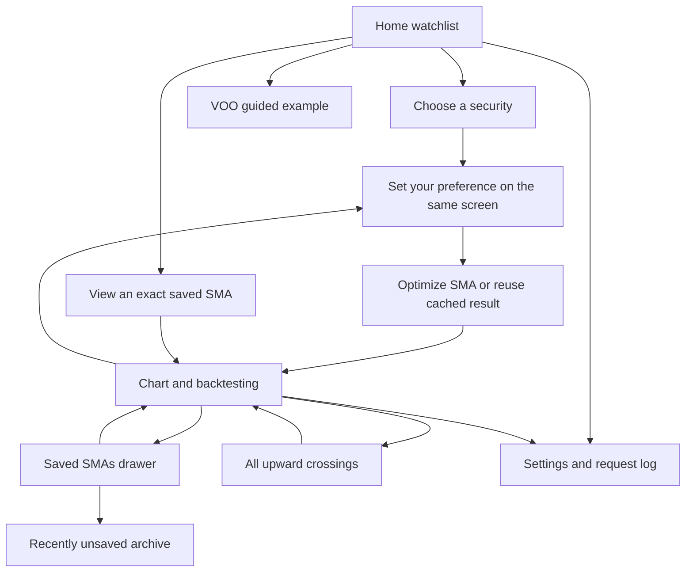

# Current app behaviour and calculation rules

Current source: **0.14.1**. Android and desktop are active. Native iPhone
releases are paused; [the Vercel/PWA app is implemented and awaiting deployment](docs/PRIVATE_IPHONE_INSTALLATION.md).
This document describes the current app, including its material limitations.

Android distribution uses an explicitly signed release variant. CI verifies the
final APK's certificate, release flags, permissions and component protections.
Version 0.13.8 fixes certificate parsing for Android SDK Build Tools 37;
0.13.7 compiled successfully but failed this verification step before upload.
Automatic Android cloud/full backups are disabled for private application data.
The [package security audit](docs/ANDROID_PACKAGE_SECURITY.md) records the earlier
signing mismatch and the reported Play Protect warning, which still requires
device/Google verification. Earlier APKs with different signers cannot promise
in-place upgrades to the retained key.

## Data and persistence

Search accepts partial ticker/company names and runs on Enter or Submit only.
Selecting a supported US/SG stock or ETF loads all available completed daily
history. All SMAs for a security share that history. Desktop uses an isolated
yfinance helper; Android uses the portable HTTPS search/chart adapter.

Analysis uses **Adj Close**, including dividend and split adjustments. Ordinary
Close and corporate actions are retained for validation/resynchronization.
Missing adjustments never silently fall back to unadjusted Close. A failed
refresh retains usable prior data and reports its freshness.

Search results, prices, saved periods, names, colours, visibility, alert
preferences, archive entries and request logs survive a normal restart.
Explicitly clearing downloaded data keeps saved SMA parameters. Removing the
app or clearing Android app storage can remove all of its local data. There is
no cross-device/cloud synchronization in the current native app.

[Market-data behaviour](docs/MARKET_DATA.md) and
[desktop testing](docs/YAHOO_DESKTOP_TESTING.md) describe request/cache limits.

## Frequency and crossing rules

An SMA is the arithmetic mean of X valid trading observations. The engine
searches eligible integer periods with a history-dependent cap and the existing
coverage/gap exclusions; it minimizes the error from the target annual rate.
Exact arithmetic resolves frequency ties, with the shorter period preferred.

For live data:

```text
observed annual frequency = crossings × 365 / observable calendar days
```

Observable time sums elapsed days between adjacent usable price/SMA points.
Warm-up and broken intervals are excluded. Weekends/holidays between valid
closes count. A target of X/year is the closest historical annualized average,
not exactly X events in every January–December year or a forecast.

Upward crossings follow below/equal/above rules, resetting across gaps. Their
markers and scenario-a entries use the intersection of daily price/SMA line
segments, attributed to the confirming session. They are not live tick data or
proof of an achievable intraday fill. [Calendar policy](docs/CALENDAR_YEAR_FREQUENCY.md).

Live 1Y/3Y/5Y and custom-year horizons use 365 days per year; month presets use
calendar months. Date-free offline reference fixtures retain their 252-session
approximation. The period cap still measures history in trading observations;
it does not redefine a live calendar year.

## Navigation and chart controls



Library lists real saved securities; none is selected at live startup. Company
accordions start collapsed each launch and share expansion state during the
session. Saving, restoring, naming, colouring and hiding lines retain their
identities. Viewing a saved SMA opens its exact period without retuning it.
Hidden lines can still alert when enabled. The archive keeps ten recent unsaves.

Home, Charts, Alerts and Settings are persistent bottom tabs. The chart's magnifier-plus starts a new security
selection. Back dismisses the keyboard/sheets before traversing pages and exits
only from Library. The guided example uses **Vanguard S&P 500 ETF (VOO)**,
initially 4/year and Max, independently of the selected security.

Charts use 3M/6M/9M/1Y/3Y/5Y/Max presets (unavailable longer ranges are omitted).
One-finger movement inspects the nearest visible EOD point. Two fingers pinch
continuously; lifting one ends the gesture without an extra jump. Zoom out or
reselecting the preset restores its base range. Chart zoom does not change the
optimization objective or investment horizon.

Below the company logo/name, the first and last finite adjusted closes inside
the visible bounds define the currency and percentage change. Both arrows and
values are green/up or red/down; flat/empty states are neutral. A preset says
PAST 3M/etc, and pinch displays actual endpoint dates. No interpolation or
network request is needed for this comparison.

## Backtesting

The independent horizon selector offers 1Y/3Y/5Y/Max and Custom years.
Each scenario contributes USD 100 per purchase and holds fractional units to
the final eligible close. These are price-ratio comparisons; no historical FX
conversion is performed for SGD quotes.

| Scenario | Entries |
| --- | --- |
| a. At N upward crossings | Interpolated crossing prices within the chosen horizon. |
| b. At N equal periods | DCA at the start of each of N equal calendar intervals; N=1 uses the start. Missing targets advance to eligible closes with distinct dates. |
| c. At N random points | 500 reproducible samples of N distinct eligible EOD dates. |

Random sample arithmetic mean purchase prices are rounded to the nearest whole
dollar, half up. The most frequent dollar group wins; ties prefer the group
nearest the overall median and then the lower dollar. The displayed result is
an actual sample nearest the winning dollar, with seed order breaking ties.
Its ending value uses each individual purchase price, not a budget divided by
an arithmetic average price.

The panel shows total contributed and ending values, a's growth relative to
contributions, and b/c ending-value differences versus a. Zero/undefined cases
are labelled appropriately. The footer ranks a against the 500 random samples
by the fraction with a **strictly higher arithmetic average purchase price**;
this is not an ending-return percentile. Fees, taxes, slippage and currency
movements are excluded; dividends are not added twice.

## Notifications and diagnostics

There are three phone types: Buy signal, Impending buy signal (End of trading)
and Impending buy signal (Start of trading). Each saved line has a phone switch
and its own switch for every type; Settings holds a master switch per type, and
all three must be On for a line to receive that type. All types and newly saved
line switches default On while existing stored Off choices remain Off. Actual OS
permission, channel settings, Focus/Do Not Disturb and scheduling policy still
control presentation and execution.

[The notification guide](docs/ANDROID_DAILY_NOTIFICATIONS.md) defines the four
SGT jobs, stale/holiday handling, duplicate suppression and tests. Desktop runs
interactive data requests only. The iPhone web app still requires a server
scheduler and Web Push; browser timers cannot preserve native background work.

The copyable request log separates logical APP operations, actual HTTP calls,
CACHE hits and notification checks/triggers/delivery outcomes. Tokens, cookies,
raw response bodies and private paths are excluded. An OS/push acceptance
record is not proof that a user saw a banner.

Legacy email market-alert delivery and Google authorization remain removed. Optional release-update signup is separate and hidden until the server is configured. Legacy SQLite email
columns/preferences remain solely for upgrade compatibility; old email events
cannot be dispatched. [Validation status](docs/ANDROID_TEST_STATUS.md).
