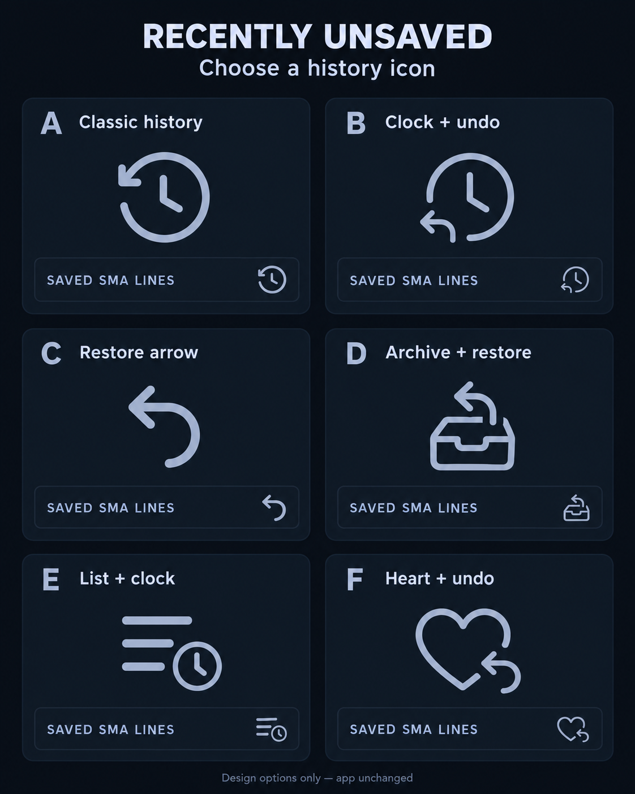

# Recently unsaved: icon options

Choose one option, A–F. This sheet is an illustrative design comparison;
the app's current icon has not been changed.

| Option | Style |
| --- | --- |
| A | Classic history: circular return arrow with clock hands |
| B | Clock with a separate undo arrow |
| C | Simple curved restore arrow |
| D | Archive tray with a restore arrow |
| E | List with a small clock |
| F | Heart with an undo arrow |

A is the clearest conventional history symbol. E emphasizes a list of recent
items. Each option includes a small header example; the chosen icon will be
drawn as a native Kivy canvas icon and checked at its actual phone size.
