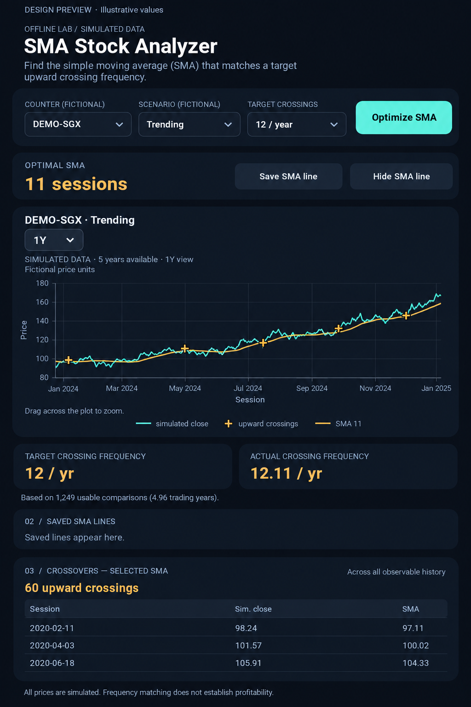

# Proposed five-year data and interface layout

This is a **design preview**, not a screenshot of implemented changes. Numbers,
dates, and chart shapes are illustrative. The actual app will calculate its
results and retain simulated-session labels. Application code is unchanged.

The proposed update includes five years of mock prices, a 1Y-default dropdown
with 1Y / 3Y / 5Y / Max (unavailable longer ranges omitted), outlined plus-sign
crossover markers, symbol-based legends, a full-width Optimal SMA card and its
save/hide actions above the chart, two frequency cards below the chart, and the
crossing count inside the crossover section. Analysis continues to use all
observable history regardless of the selected chart view.
