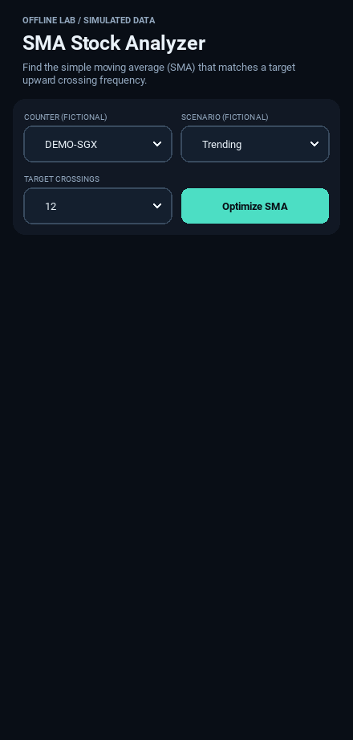
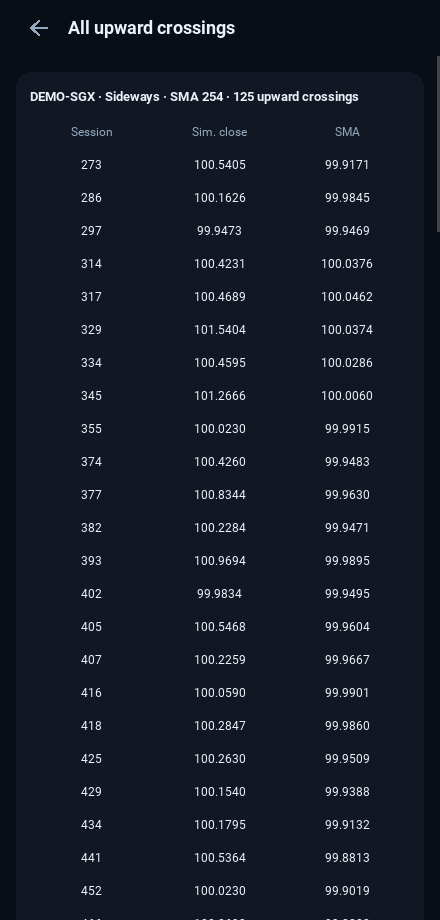
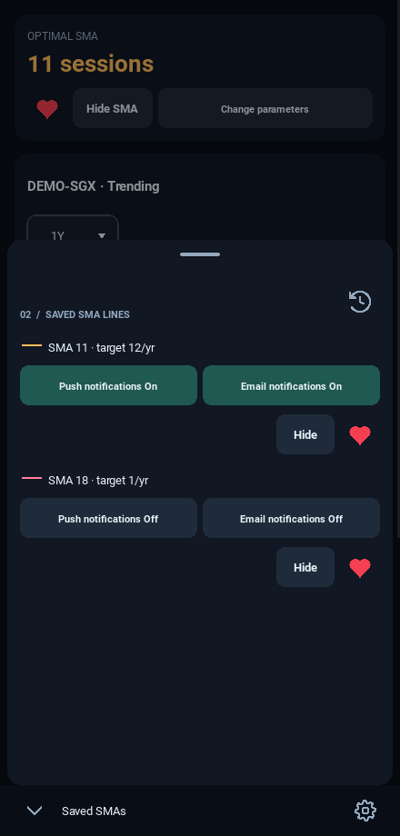
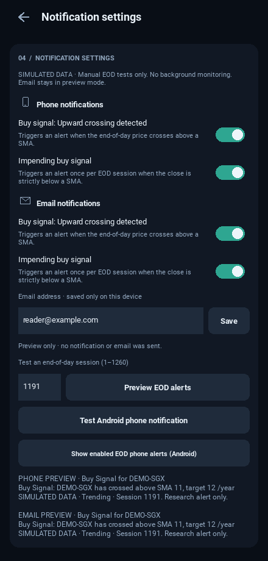

# Screen layout of the running app

Version **0.7.0** implements the approved library-first structure. The
[full-app review](design/library-first-review/README.md) contains captures from
the tested Kivy application with calculated results and simulated prices. Those
images were prepared before approval and retain their original review labels.

- [Complete app navigation](design/library-first-review/full-app-flow.png)
- [Start and learn](design/library-first-review/01-start-and-learn.png)
- [Analyze and compare](design/library-first-review/02-analyze-and-compare.png)
- [Save and return](design/library-first-review/03-save-and-return.png)

| View | Contents | Navigation |
| --- | --- | --- |
| Library | Empty introduction or populated saved company groups | Always opens at launch; New analysis opens Search; saved View opens exact Results |
| Search | Explicitly submitted ticker/company matches | Selecting a result loads simulated history and opens Parameters |
| Parameters | Company identity, frequency and expandable Custom settings | Optimize opens Results; Change security opens Search |
| Guide | Three-year synthetic chart, recovery/false signals and comparisons | Frequency changes recalculate only the lesson; Back returns to Library |
| Results | Company chart heading, SMA, inspection/pinch and frequency cards | Top Library/Saved SMAs/Settings; Change parameters retains the selection |
| Backtesting | Period/custom years, ending values, b/c differences and info | Within Results; all crossings opens a separate event list |
| Saved sheet | Company groups with View/Hide/heart/phone controls | Partial lower overlay; top toolbar stays usable; swipe/backdrop/Back dismisses |
| Archive | Last ten unsaved lines with small company logos | Restore recovers the exact configuration and refreshes Library |
| Settings / crossing details | Phone preferences/tests or full event list | Fixed Back returns to the prior screen |

There is no Home/Saved/Learn bottom bar. Back dismisses overlays and the
keyboard before traversing the page stack. Physical Android validation remains
pending; see the [release checklist](ANDROID_RELEASE_CHECKLIST.md).

## Historical captures through 0.6.0

The sections below describe earlier layouts. Their bottom navigation and Gmail
controls are historical and are not the current application flow.

For the **0.6.0** company identity styling, see the
[selected-security screenshot](security-identity-selected.png),
[saved SMA sheet](security-identity-sheet.png), and
[unsaved archive](security-identity-archive.png). Screenshots below record earlier
layouts; email controls shown in older captures have since been removed.

| Screen | Contents | Navigation |
| --- | --- | --- |
| 1 | App heading, parameter controls and all-counter saved SMA library | Opens at launch; Optimize SMA or a saved row's View opens 2 |
| 2 | Optimal SMA, chart, frequency cards, coverage explanation | Change parameters returns to 1; fixed bottom-left Saved SMAs and bottom-right Settings controls |
| 2a | Crossovers below the results, in the same scroll view | Starts with 5 rows; downward arrows add up to 10 at a time, through 35 |
| Expanded 2a | All selected-result crossing events | Show all opens this screen when more than 35 events exist; fixed top-left Back returns to 2 |
| 2b | Saved SMA lines in a partial bottom sheet | Opens on a new save or with the bottom-left menu; dismiss with that button, a downward handle swipe, or the dimmed area |
| 3 | Notification preferences, recipient address and preview tests | Bottom-right gear opens it; fixed top-left Back returns to 2 |

## Screen 1 — parameters

Saved rows appear immediately after launch, including other counters/scenarios.
View and the row title open the exact saved parameters without re-optimization.
Only this landing-page library replaces Hide with View; Results retains Hide.

## Screen 2 — results

[View the wider portrait results layout](ui-current.png).
The Hide SMA button is compact, beside the save heart and Change parameters.
The bottom navigation stays reachable while scrolling through results.

## Screen 2a — crossovers

[View the full scrollable results content, including its five-row crossover preview](screen-results-full.png).
Rows keep the original ascending session order. A short list stops at its actual
count. New optimization resets the preview to five; hiding/saving lines and
visiting another screen preserve the current preview length.

The full list shows every calculated event, with a fixed Back arrow even after
scrolling to the bottom. Returning preserves the results scroll position and chart.

## Screen 2b — saved lines

The lower sheet leaves the fixed bottom navigation accessible. Its top handle
accepts a downward swipe; the saved-line list scrolls independently below it.
The selected history icon remains option A, and the history popup still restores
the most recent ten unsaved configurations.

[View saved-line controls at phone size](ui-saved-lines.png).

## Screen 3 — settings

The current Settings screen adds Gmail Connect, explicit test/send and
Disconnect controls for the configured sender, shown in the tested UI screenshot.
Native Android/Google authorization needs the
[APK + Gmail setup guide](ANDROID_APK_GUIDE.md). Preview still sends nothing;
real sends require the sender account's consent. See [validation status](ANDROID_TEST_STATUS.md).

The layouts were checked at five portrait sizes, including 320 pixels wide,
and the focused Android regressions also pass at density 2 in a 440×920 dp
viewport. Native fonts can vary slightly between operating systems. The user
confirmed the prior APK's test notification works; the 0.2.1 Back/keyboard/inset
corrections need a new APK/device retest. Stock prices remain simulated.
See the [saved Android release checklist](ANDROID_RELEASE_CHECKLIST.md).

## Earlier design references

[Original illustrative mockup](ui-preview.png) ·
[History icon options, with A selected](HISTORY_ICON_OPTIONS.md).
