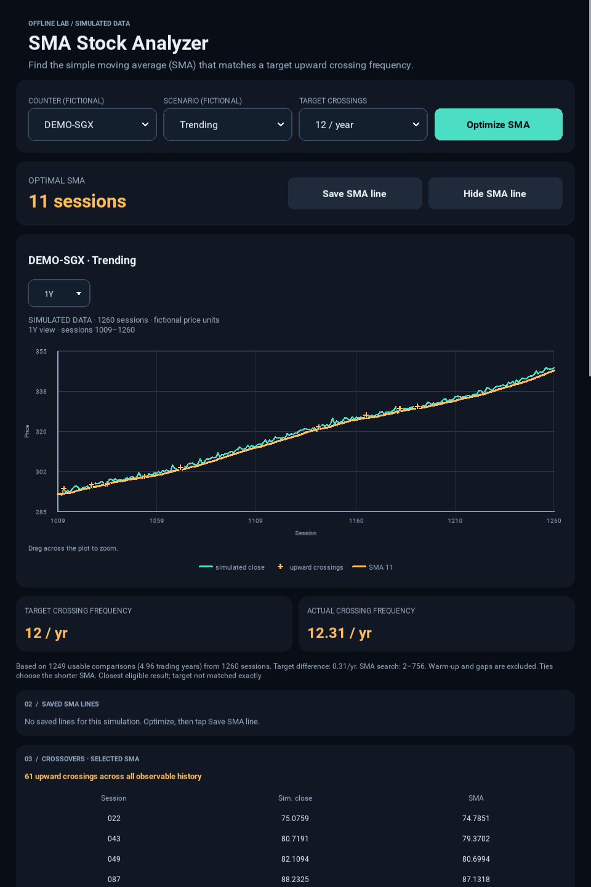
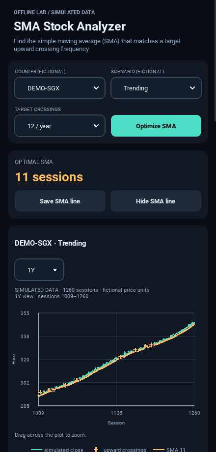

# Updated interface

The interface now follows the approved mockup's compact layout and styling.
The default view is 1Y; calculations still use all observable history.

## Screenshot of the running app

This image was captured from the tested Kivy application. Its prices are
simulated and its statistics are calculated by the active engine. The screenshot
shows a wider portrait layout with the controls in one row and the Optimal SMA
value beside its save/hide buttons. Rounded, outlined selectors include visible
arrows, and the chart legend is centered.

## Phone layout

On narrow phones the controls form a two-by-two grid, and the Optimal SMA buttons
sit below its value. These adaptations preserve readable text and touch targets
at 320 pixels wide. The app starts at 440 × 920; widen the portrait window to at
least 760 display-independent pixels to see the four-column controls.

Loading, save feedback and errors appear below the controls when needed. The
ordinary completed state keeps that area compact. Both images are captures of
the running app, rather than generated design images.

## Original design reference

[View the approved illustrative mockup](ui-preview.png). Its dates and numbers
were placeholders; the actual app uses simulated session numbers and computed
values, as shown above. Prices, selected periods and crossing statistics will
therefore differ from the original mockup. Native font rendering may vary
slightly between operating systems; Android device validation is still pending.
