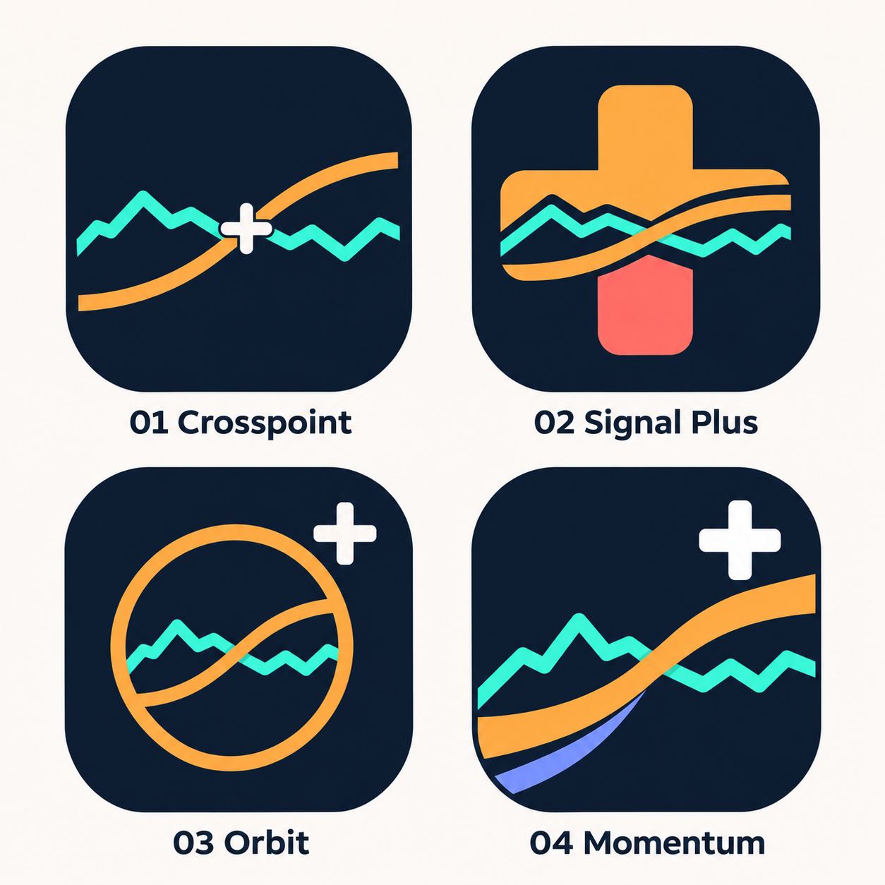

# Four app logo proposals

[Open or download the full-size comparison sheet](four-logo-proposals.png).

Each option includes a plus sign, an orange SMA crossing above a turquoise
price line, and the app's navy/bright-colour direction.

| Option | Direction |
| --- | --- |
| 01 Crosspoint | A clean crossover with a plus at the intersection. Strongest starting point for small app-icon sizes. |
| 02 Signal Plus | A large integrated plus with the two lines running through it and a coral accent. |
| 03 Orbit | A circular crossover emblem and a separate plus. |
| 04 Momentum | A bold rising ribbon with a bright plus and periwinkle accent. |

Palette targets taken from the running app: navy **#131F31**, default SMA amber
**#FFBD5C**, price turquoise **#4DDEC4**. These are generated concept previews;
final vector geometry, exact colours and Android/iPhone icon exports can follow
the chosen direction. The proposals have not replaced the installed app icon.
