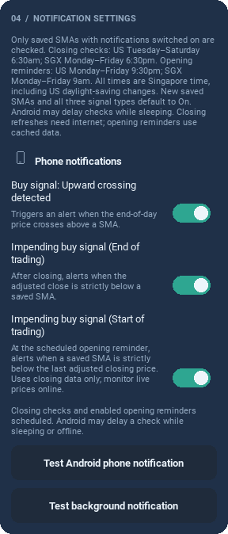
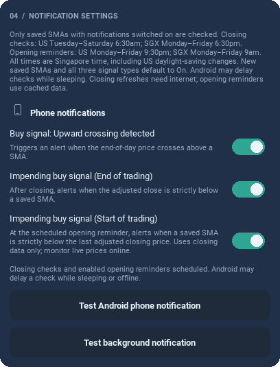

# 0.13.0 notification settings

Captures of the running Kivy UI at 320px and 440px, using controlled mobile HTTP
and native-bridge fixtures. The Android background-test button is shown; these
images do not prove physical background delivery.

The three independent switches show their separate conditions and fixed
Singapore-time schedules. The background test uses the real native path after
installing the APK; the screenshot harness mocks its native queue command.

See the [release notes](../../RELEASE_0_13_0.md) and
[Android background test and request-log guide](../../ANDROID_DAILY_NOTIFICATIONS.md).
