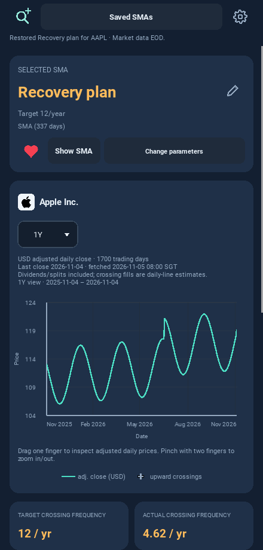
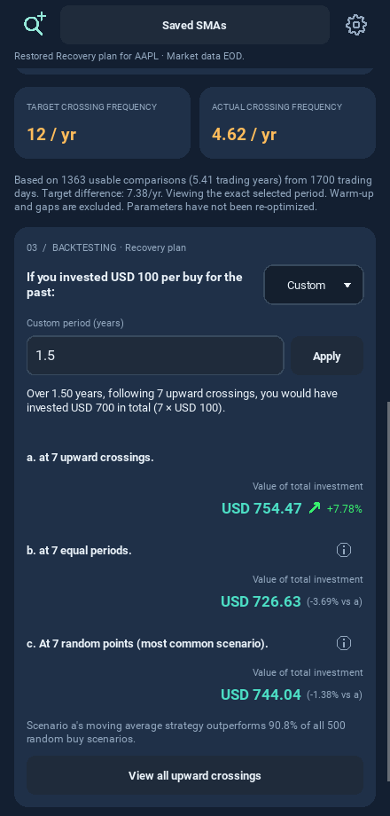
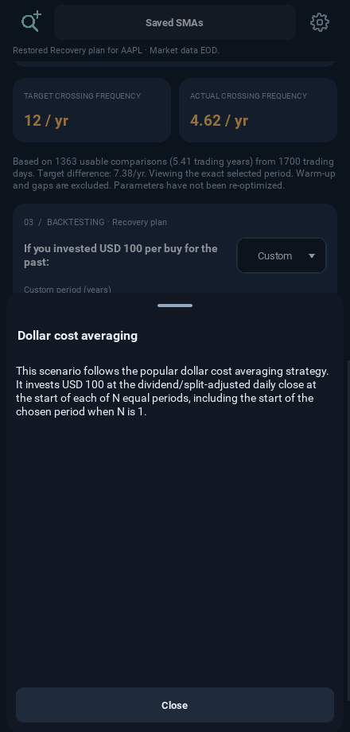
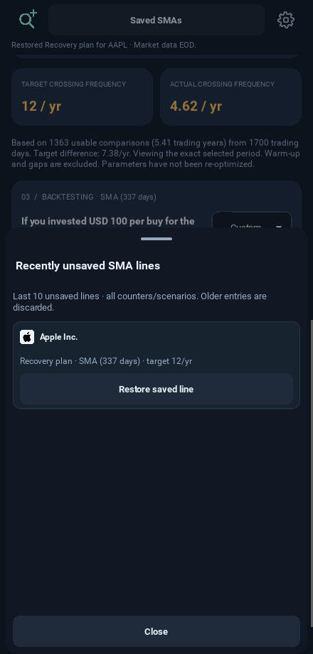
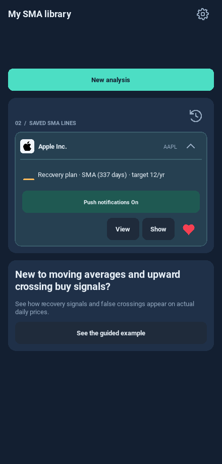
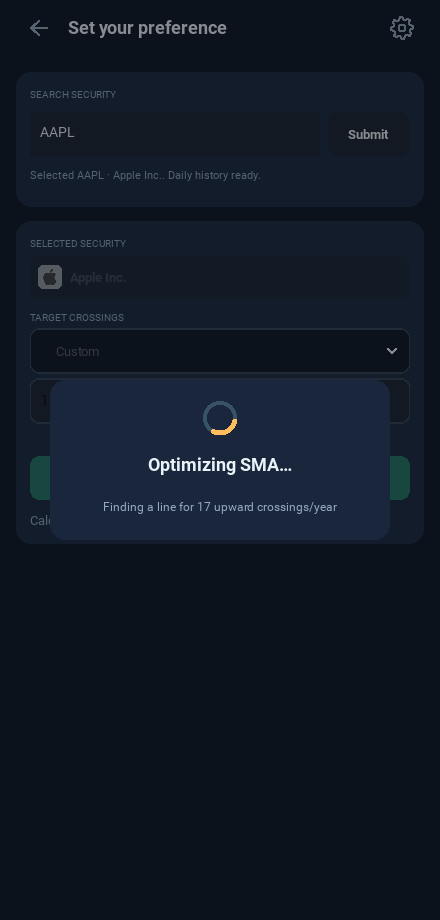

# Android 0.10.2 — UI screenshots

These screenshots come from running Kivy checks using controlled mobile HTTP
fixtures. Company identities are real; the displayed prices and returns are
test data. No user's cached history or uploaded video is included. Still images
show the final states; page/drawer/dropdown animation and cancellation are
verified by the running UI checks described in the [release notes](../../RELEASE_0_10_2.md).

## Chart header

## Custom backtesting

## Help drawer

## Recently unsaved drawer

## Expanded library

## Optimization loading

The [complete app flow](../ui-0.10/README.md) retains the same six-page structure.
