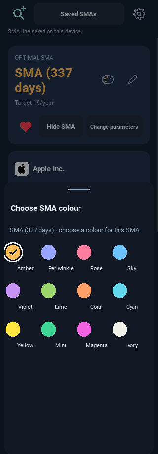
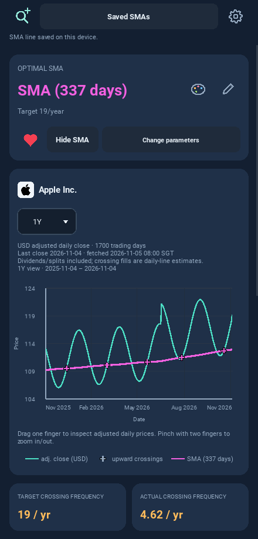
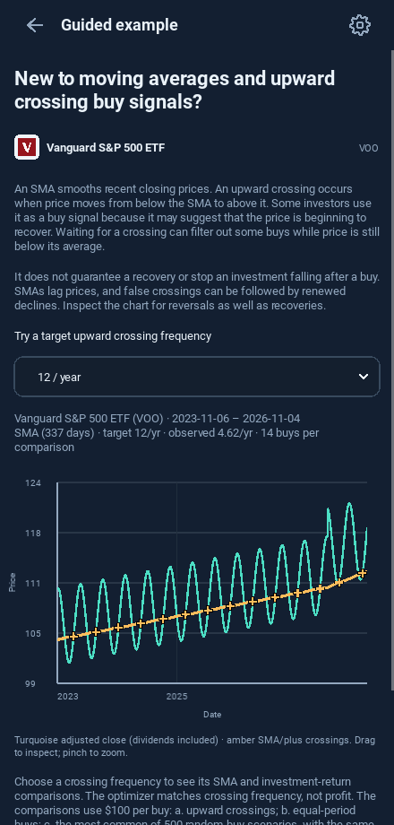
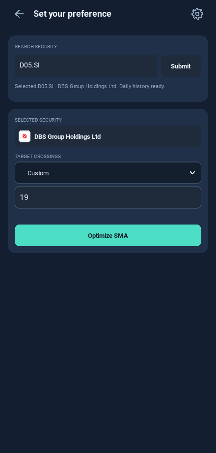
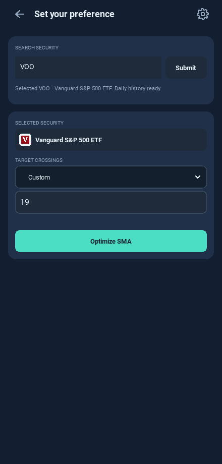
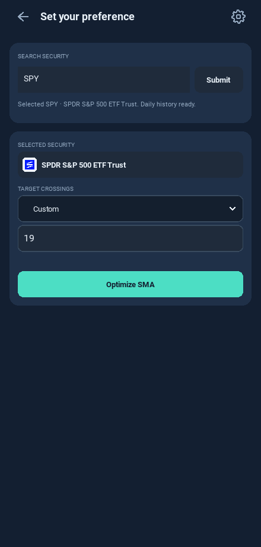
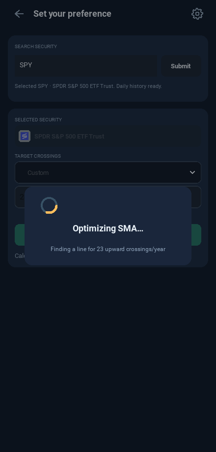

# Android 0.10.3 — colours, VOO and company/issuer logos

These screenshots use controlled mobile HTTP fixtures. Identities are real;
displayed prices and returns are test data. No uploaded video or user cache is
published. Still images show final states; running checks test continuous motion,
colour persistence and the API/cache path.

## Twelve-colour picker

## VOO guided example

## DBS company logo

## ETF provider logos

## Continuous loading

See [release notes](../../RELEASE_0_10_3.md),
[logo coverage and sources](../../OFFLINE_LOGO_CATALOGUE.md) and the unchanged
[six-page app flow](../ui-0.10/README.md).
