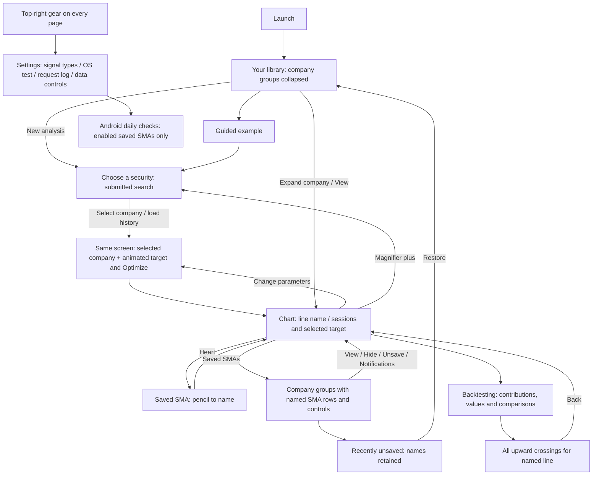
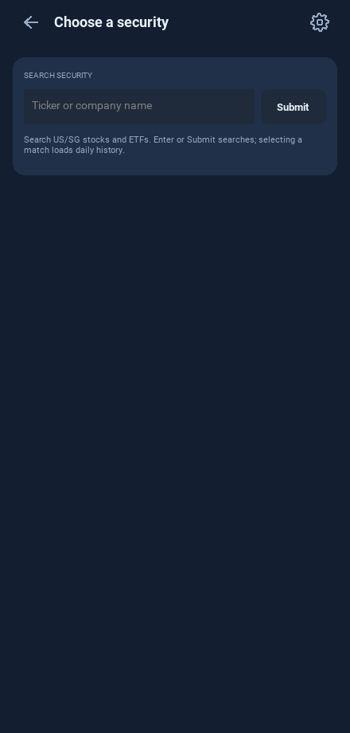
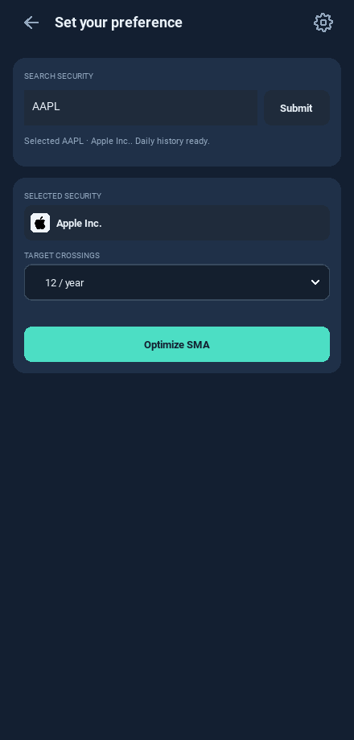
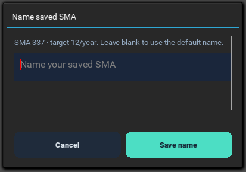
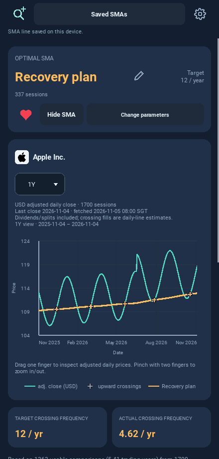
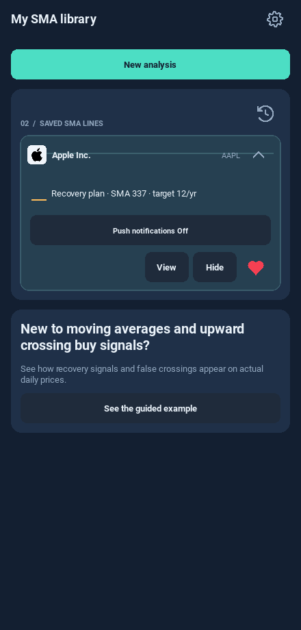
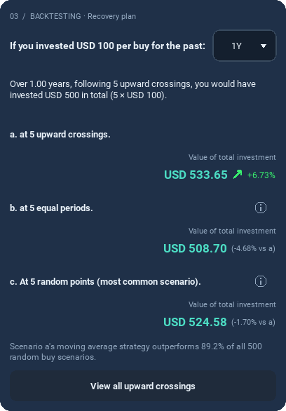
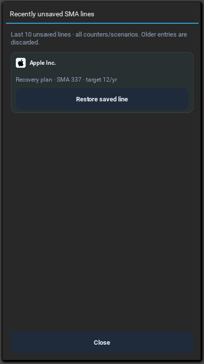
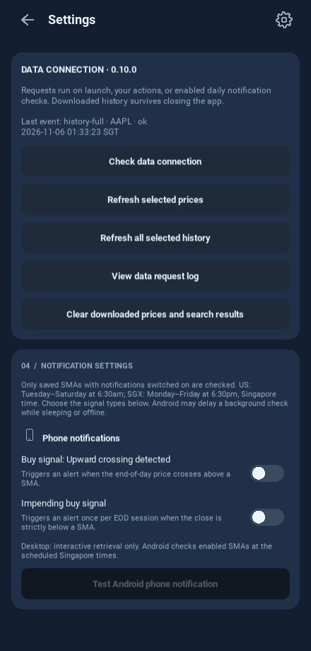

# One-screen setup and named SMAs

These screenshots use controlled HTTP responses and fictional prices. Company
names are real; displayed prices/returns are not market observations. Desktop
previews show Android notification timing/scope; they do not demonstrate native
sleeping-phone delivery.

After selection the heading changes and the lower controls reveal on the same
screen. A still screenshot shows the completed 280ms animation.

