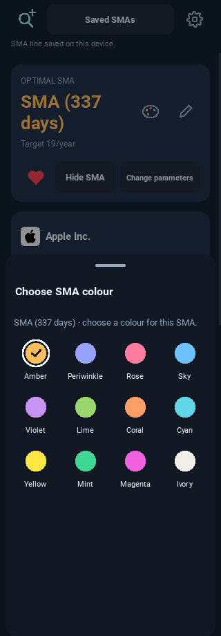
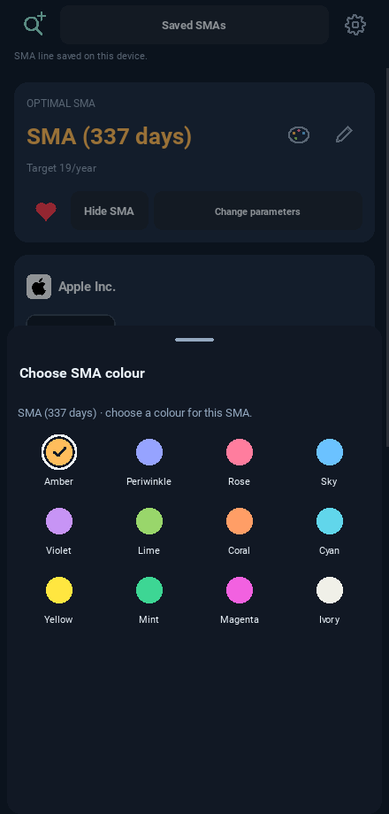

# Centred SMA colour palette — 0.11.0

Every swatch is centred above its label, including the selected ring. These
images use controlled mobile HTTP fixtures; displayed prices and returns are
test data. They contain no user cache or uploaded screenshot/video.

## Narrow phone layout (320)

## Wider phone layout (440)

The running UI checks measure the actual canvas circles against their buttons'
centres and bounds, then exercise colour selection and archive/restore.

See [release notes](../../RELEASE_0_11_0.md) and the
[iPhone installation guide](../../PRIVATE_IPHONE_INSTALLATION.md).
