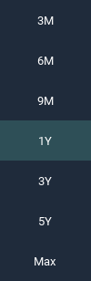
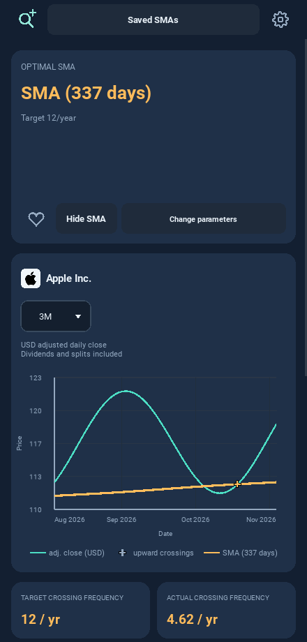
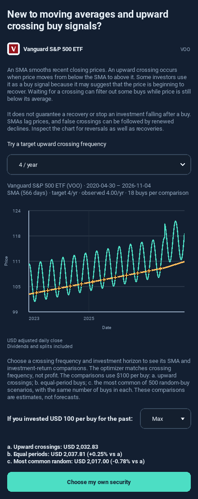
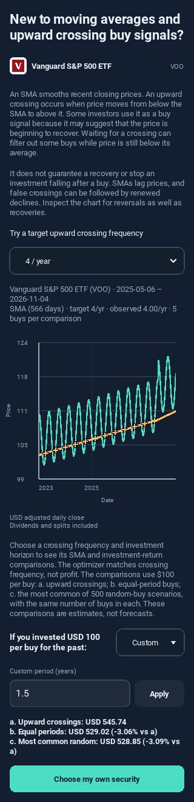
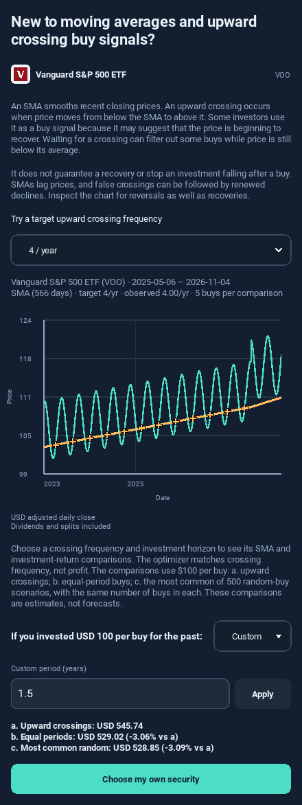

# 0.12.0 chart and guided-example review

These are captures of the running Kivy UI using **controlled test data** through
the mobile JSON adapter. Names/logos identify the intended securities; prices
and returns here are fixtures, not actual VOO/Apple investment performance.

The chart menu now begins with **3M, 6M, 9M**. The result page keeps its company
identity, legend and controls, with just the two requested descriptive lines and
no usable-comparisons paragraph above backtesting.

The guided example initially selects **4/year** and a **Max** investment horizon.
Its horizon selector offers 1Y, 3Y, 5Y, Max and Custom years. Changing the horizon
reuses the loaded data and SMA; changing frequency can calculate a different SMA.

Custom horizons use the same animated input as the main backtesting section.
The layout was checked at 320px and 440px phone widths.

See the [release notes](../../RELEASE_0_12_0.md),
[Android guide](../../YAHOO_ANDROID_TESTING.md) and
[iPhone guide](../../PRIVATE_IPHONE_INSTALLATION.md). Native build completion and
physical-device behavior remain separate from these Linux UI checks.
