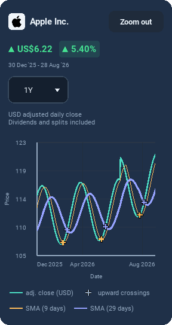
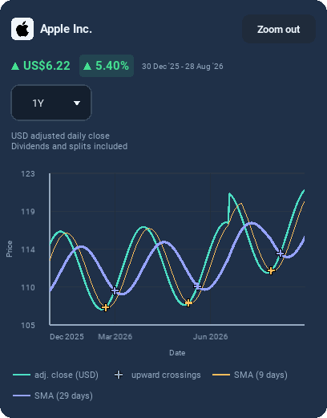
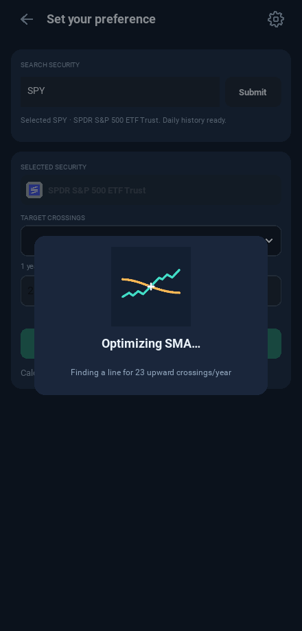

# Chart comparison and upward-crossing logo — 0.13.2

These are captures from the Kivy implementation using controlled test prices,
not a record of live market performance. Android and iPhone share this UI.

## Visible-range comparison

Preset views show PAST 3M/6M/etc. Pinch zoom shows actual endpoint dates and
recalculates from the visible adjusted closes without a data request. Both
arrows and values turn green/up or red/down. Full dates move to a second line
when they need more space on a narrow phone.

Direction examples below use explicit $100→$110 and $100→$90 test inputs:

## Logo drawing while optimizing

This GIF is rendered by the actual GPU widget. Its turquoise price crosses
the orange SMA from below. Both paths draw left to right; the white plus
appears at their intersection. The cycle continues until completion or native
Back/Escape cancellation, with no artificial delay for cached results.

[Open the rendered still frame](loading-logo-complete.png).

The same corrected master supplies Android/iOS launcher and static launch
images. [View or download the app icon](../selected-logo/README.md).

Native installation checks still run in GitHub's mobile workflows. These
screenshots demonstrate the shared Kivy rendering, not physical-device validation.
