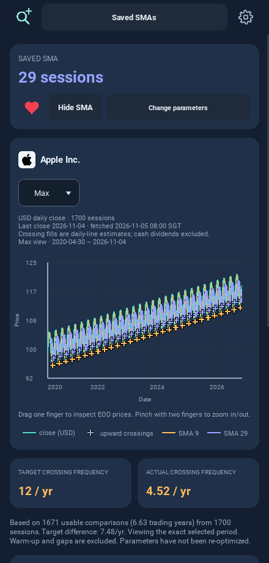
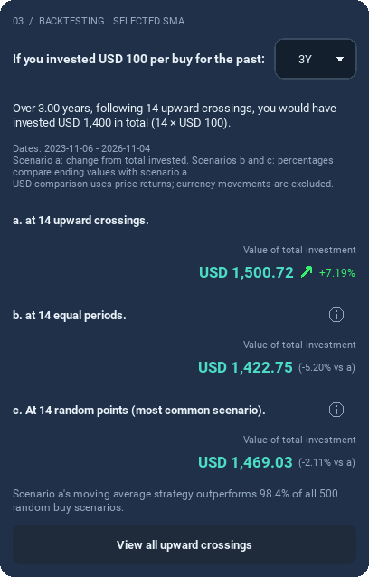
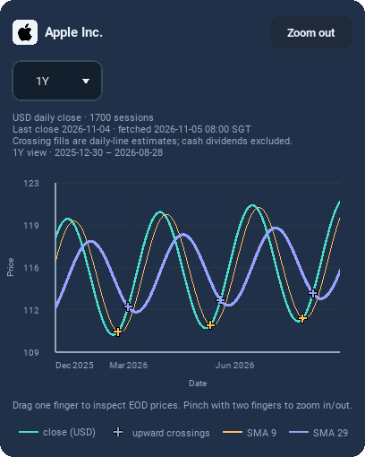
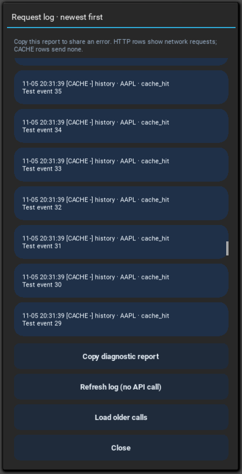
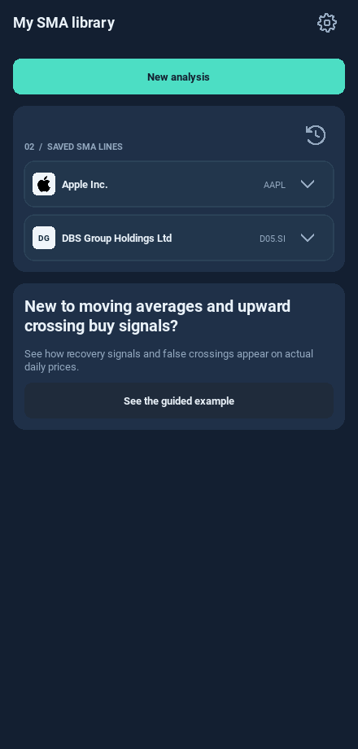

# UI refinements for 0.9.0

These are screenshots of the implemented Kivy screens using **controlled test
prices and HTTP responses**. The company names are real; the chart values and
returns in these previews are test fixtures, not actual market results.

The selected icon is a thin mint magnifier with a small plus at the top right.
It uses the app's own vector drawing so its appearance is consistent across
Android, desktop and future iPhone builds. Its touch target remains 44 dp.

The axis switches between measured month/year labels and spaced years. This
close view shows month labels while the full-history Results view above shows
years. A still image cannot demonstrate pinch smoothness; test that in the APK.

The list of requests scrolls independently; the controls stay below it. Load
older calls reads local history and Copy copies all currently loaded entries.

Every company starts collapsed on a fresh launch.

