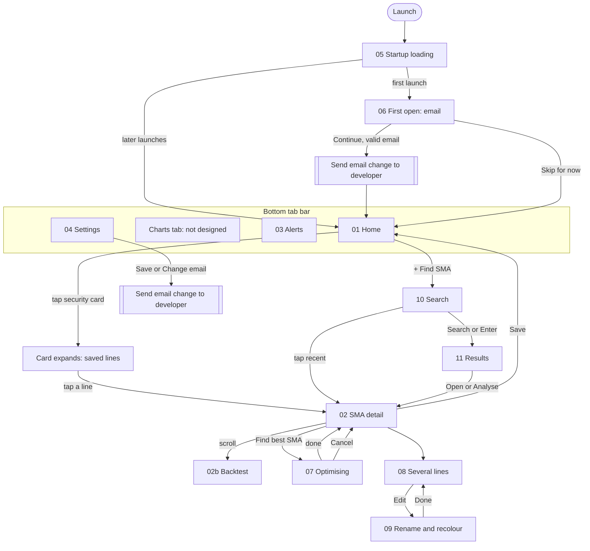
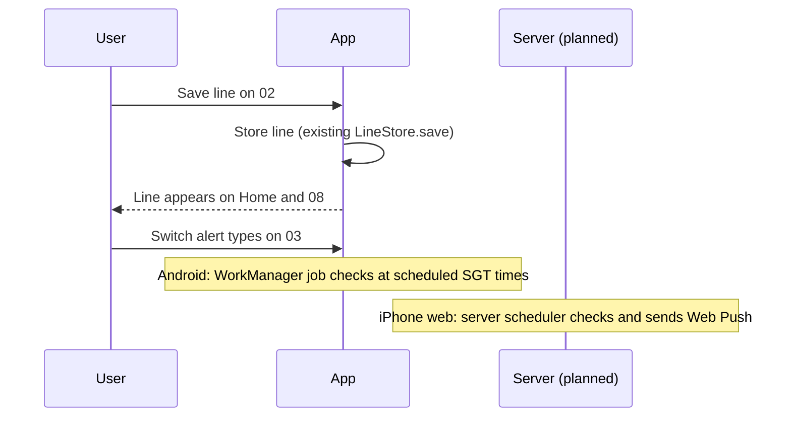

# Navigation and interaction flows

GitHub renders these diagrams. Screen numbers refer to [screens.md](screens.md).

## App structure

## Rules

- **Back**: every pushed screen (02, 08, 09, 10, 11) has a visible ‹ Back. Android hardware/gesture Back does the same. The iPhone Home Screen app has no browser Back button, so the on-screen Back is required there.
- **Tabs** keep their own stack; tapping the active tab returns to its root.
- **Sorting on Home**: securities with any line below its SMA first, then the rest; keep saved order within each group.
- **Expanded cards**: the app currently closes all groups on launch. The prototype opens the first card. See open decisions.
- **Search**: one request per Search press. Editing the text does not search. Recent items never trigger a request.
- **Optimising**: cancelling stops the job and ignores any late result. The chart stays as it was.
- **Rename/recolour**: changes apply live; Done closes the sheet. Blank name falls back to "SMA (N days)".
- **Email**: submit and change both send a message to the developer. Skip sends nothing. The email can be added later in Settings.

## Saving and alerts sequence

