# Screen catalogue

Status key:
- **Approved** — reviewed and iterated with the app owner during the design session.
- **Proposal** — added for this handover to cover required states. Not yet reviewed by the owner. Confirm before building.

Every screenshot is 2× and includes its screen label. Sample values (prices, counts, backtest results, dates) are illustrative only; real values come from the existing calculation code.

## Approved

### 01 · Home
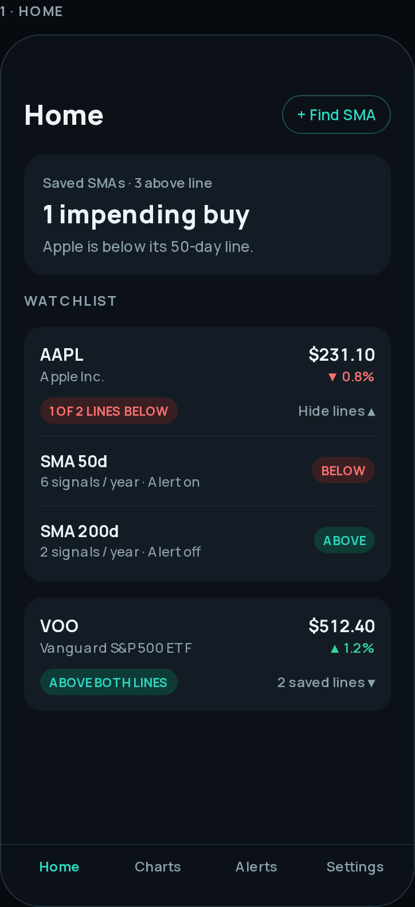

State: [both cards expanded](screens/states/01-home-both-expanded.png).

- Replaces the Library page. Saved lines are grouped by security, one card each.
- Securities with any saved line below its SMA sort to the top.
- Collapsed card: logo, company name, ticker · market, price and change, a summary tag ("1 OF 2 LINES BELOW" / "ABOVE BOTH LINES") and the saved-line count. Tap to expand; each line shows its name, signals per year, alert state and an ABOVE/BELOW tag.
- Summary card at the top ("1 needs attention").
- Bottom tab bar with text labels: Home, Charts, Alerts, Settings. Replaces the gear icons and the Saved SMAs bottom sheet.
- The prototype shows tickers as the card title. Use the company name (see screen 11) for consistency; see open decisions.

### 02 · SMA detail (chart)
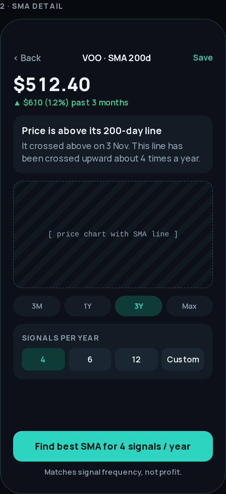

- Header: Back, security · line, and a text "Save" action (replaces the heart icon).
- A plain-language status sentence comes before the chart: "Price is above its 200-day line. It crossed above on 3 Nov. This line has been crossed upward about 4 times a year."
- Range chips, then a signals-per-year segmented control (4, 6, 12, Custom). Custom is always visible as the last segment (replaces the hidden "Custom +").
- Primary action: "Find best SMA for N signals / year", with the note "Matches signal frequency, not profit."
- Keep the app's existing range set and chart gestures; the chips in the prototype are illustrative.

### 02b · Chart, scrolled to backtest
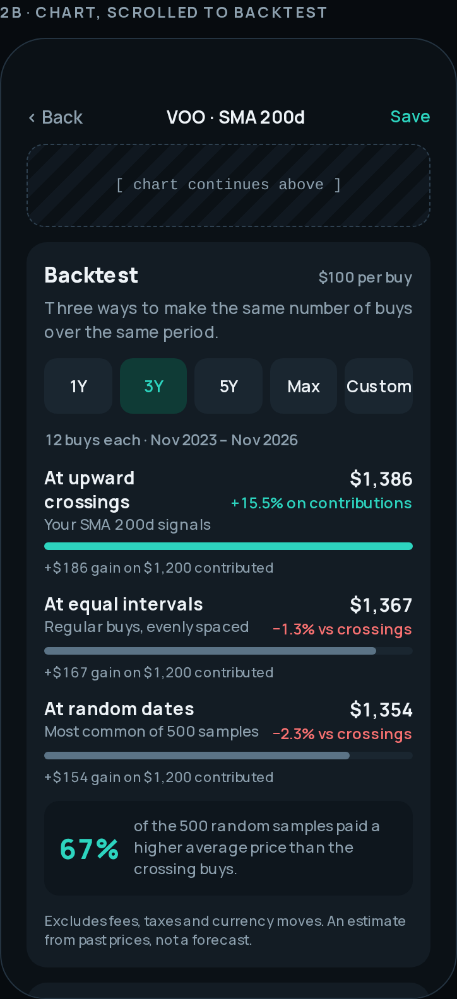

- Horizon chips: 1Y, 3Y, 5Y, Max, Custom. Custom shows a years field (1–16 in the prototype; use the app's real limits).
- Three rows, named in plain words: "At upward crossings", "At equal intervals", "At random dates (most common of 500 samples)". Each shows ending value, difference versus crossings, a bar and "gain on contributed".
- One summary statistic: share of the 500 random samples that paid a higher average price.
- Footnote: excludes fees, taxes and currency moves; an estimate, not a forecast.
- All figures must come from `backtest.py`. The prototype's numbers are generated placeholders.

### 03 · Alerts
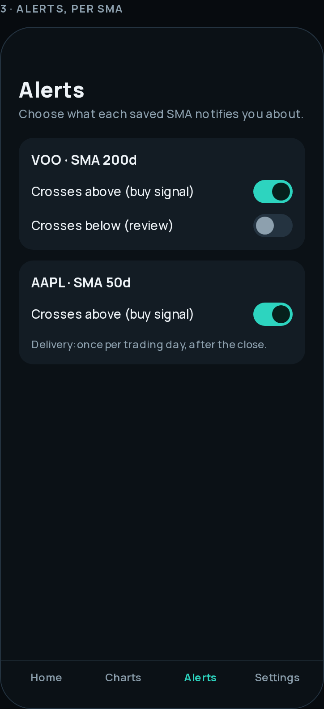

- One card per saved line, with switches. Delivery note under each card.
- **Copy and model must be corrected before building**: the prototype labels ("Crosses above (buy signal)", "Crosses below (review)") do not match the app's three types. See open decisions.

### 04 · Settings
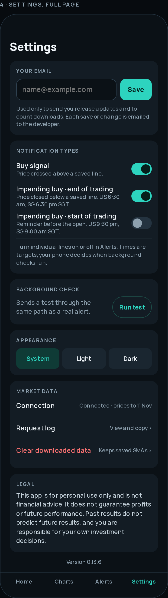

State: [email saved](screens/states/04-settings-email-saved.png).

Top to bottom: Your email (input + Save, or saved address + Change), Notification types (three switches with schedules in Singapore time), Background check (Run test), Appearance (System / Light / Dark), Market data (Connection, Request log, Clear downloaded data), Legal disclaimer, version.

- Keep every existing diagnostic action: Test Android phone notification, Test background notification, View data request log, Copy diagnostic report. The prototype shows only one test button.
- Show the real version number (repo is at 0.13.8; the prototype says 0.13.6).
- Legal text (draft, not reviewed by a lawyer): "This app is for personal use only and is not financial advice. It does not guarantee profits or future performance. Past results do not predict future results, and you are responsible for your own investment decisions."

### 05 · Startup loading
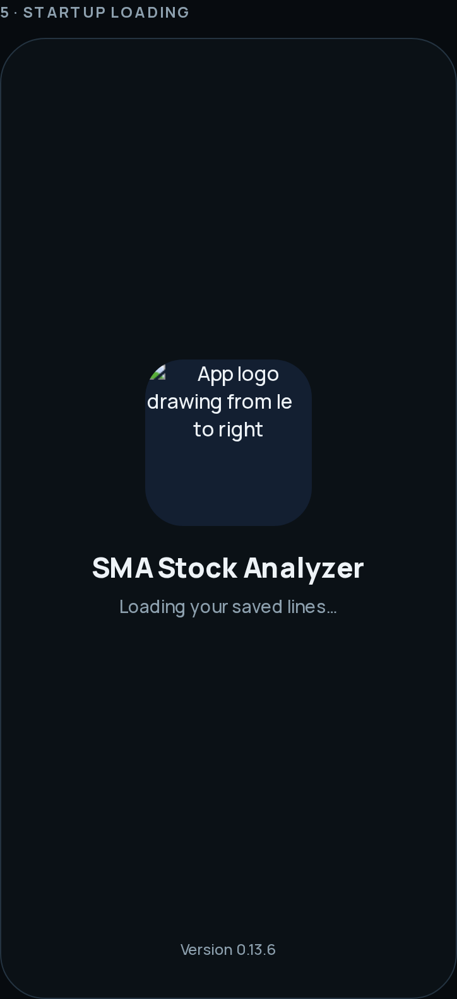

App icon with the logo-draw animation, app name, "Loading your saved lines…", version.

### 06 · First open, email
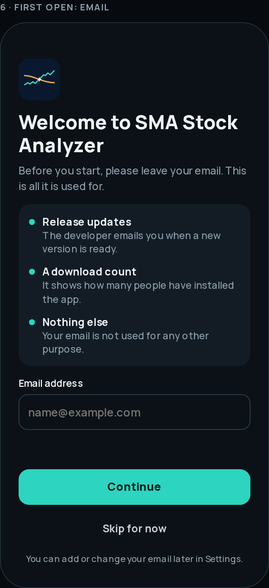

States: [invalid email](screens/states/06-email-invalid.png), [email saved](screens/states/06-email-saved.png).

- Shown once, on first launch. Explains the three uses: release updates, a download count, nothing else.
- Email field, Continue, **Skip for now** (approved), and "You can add or change your email later in Settings."
- Validation message: "Enter a valid email address, like name@example.com." (match `notifications.validate_email`).
- After saving: "Email saved and sent to the developer", the address, "Use a different email", and "Open the app".
- Every submit or change must reach the developer by email. See [web-iphone.md](web-iphone.md#developer-contact-email) for the required server endpoint.

### 07 · Calculating an optimal SMA
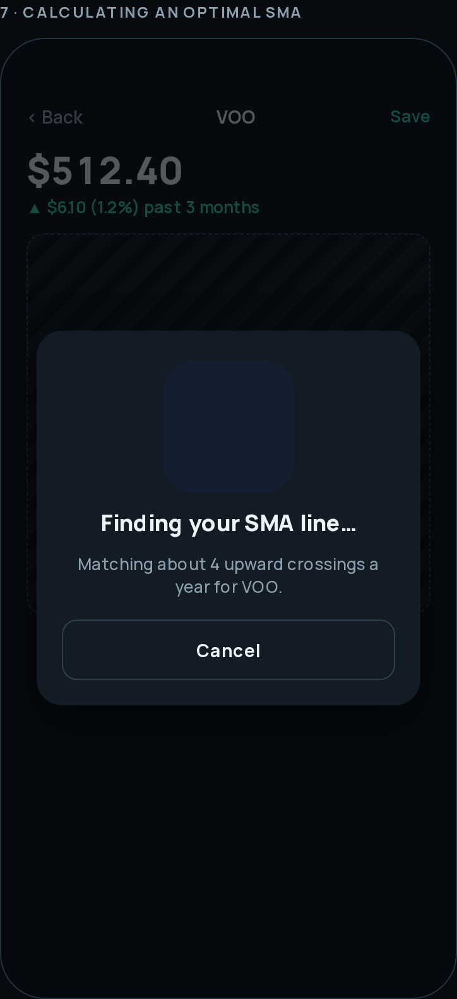

Card over a dimmed chart: animated logo, "Finding your SMA line…", "Matching about 4 upward crossings a year for VOO.", and a visible **Cancel** button (previously only Android Back / Escape).

### 08 · Several saved lines on one chart
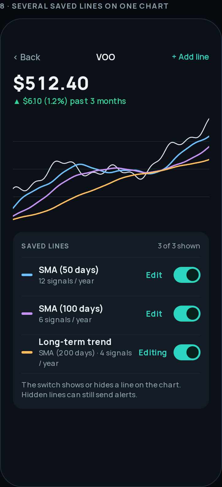

State: [after renaming and recolouring](screens/states/08-lines-after-edit.png).

- Price plus every visible saved line for the security, each in its saved colour.
- "Saved lines" list: colour swatch, name, period · signals per year, Edit, and a show/hide switch. "2 of 3 shown" count.
- "Hidden lines can still send alerts" (matches the app's rule).

### 09 · Rename and recolour a line
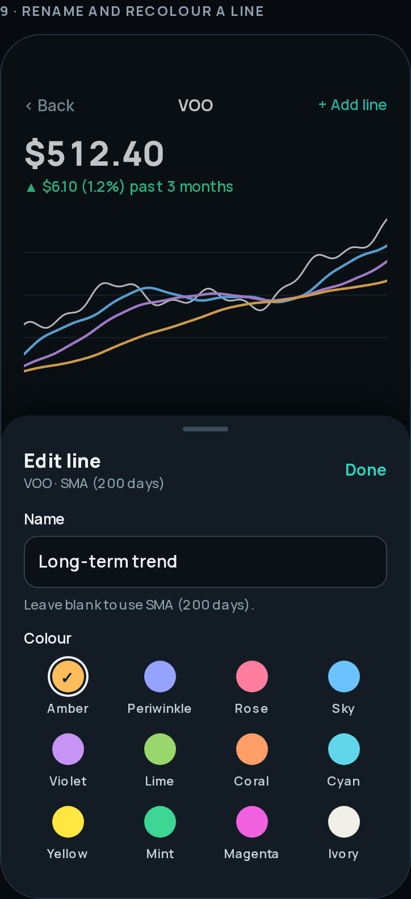

State: [renamed "Quick swing", Rose selected](screens/states/09-renamed-recoloured.png).

- Bottom sheet: Name field (placeholder and fallback = "SMA (N days)"), the 12 named colours in a 4 × 3 grid with a check and ring on the selected one, Done.
- Changes preview live on the chart.
- Name limit: **60 characters** (`line_names.normalize_name`). The prototype caps at 24; follow the code.

### 10 · Search, before searching
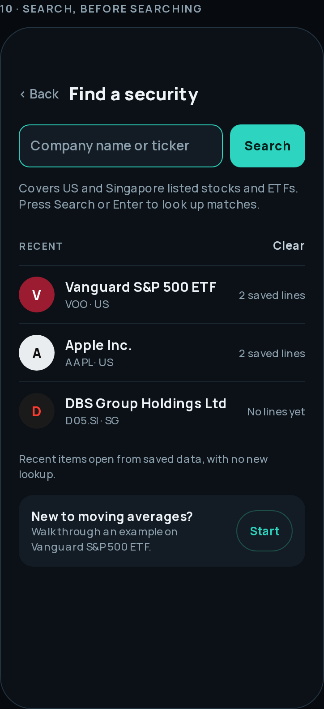

Field "Company name or ticker" with a **Search** button, coverage note, Recent list (opens from saved data with no new lookup), Clear, and the guided-example shortcut.

### 11 · Search, after pressing Search
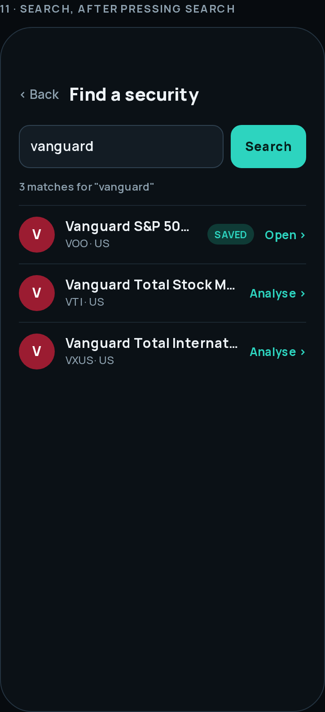

State: [no results](screens/states/11-search-no-results.png).

- Search runs **only** on the Search button or the keyboard's Enter/Search key, never while typing (to limit yfinance requests; matches the current app).
- Each result: company logo, company name (Yahoo `longName`, then `shortName`, then symbol, as in `yahoo.py`), ticker · market, a SAVED tag if lines exist, and "Open ›" or "Analyse ›".
- If the user edits the query after searching, the old results stay with "Press Search to update these results."
- Logos in the prototype are placeholder letter circles. Real logos need a source; see open decisions.

## Proposals (not yet reviewed)

### 12 · Home, nothing saved yet
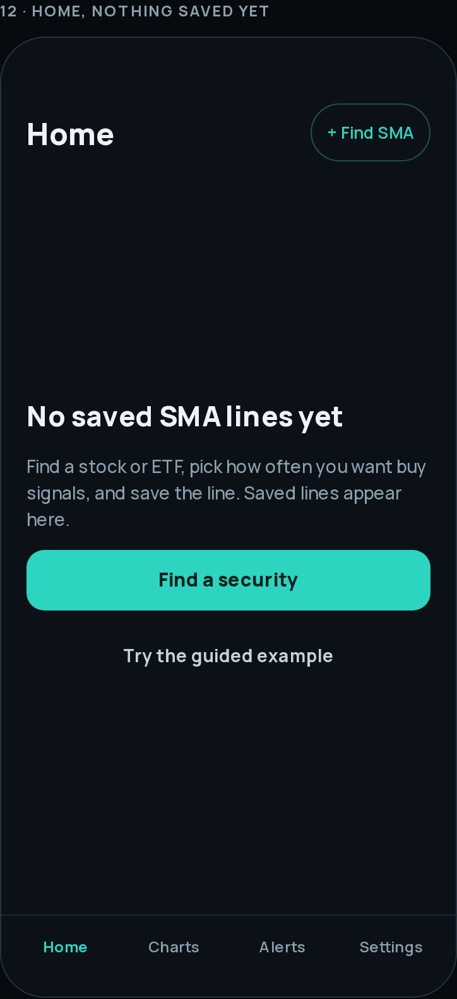

### 13 · Home, offline with cached data
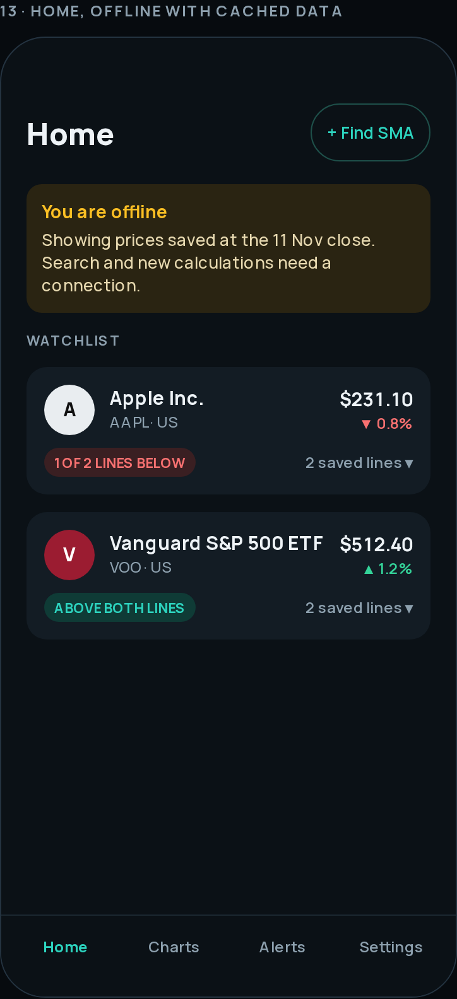

Banner: "You are offline. Showing prices saved at the [date] close. Search and new calculations need a connection." Cached cards stay usable.

### 14 · Search, data source unavailable
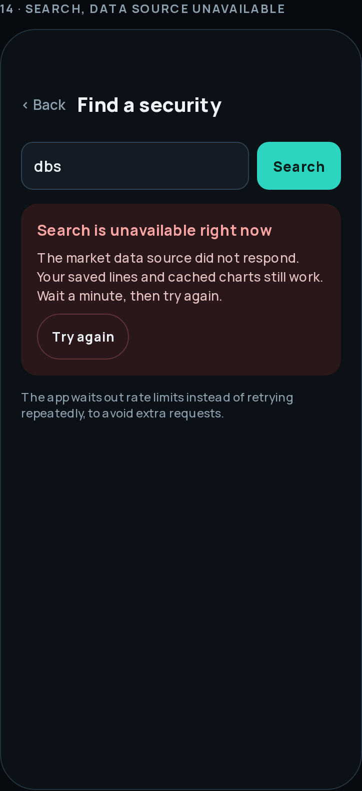

Error card with Try again. No automatic retry loop; respects the app's rate-limit cooldown.

### 15 · Search with keyboard open
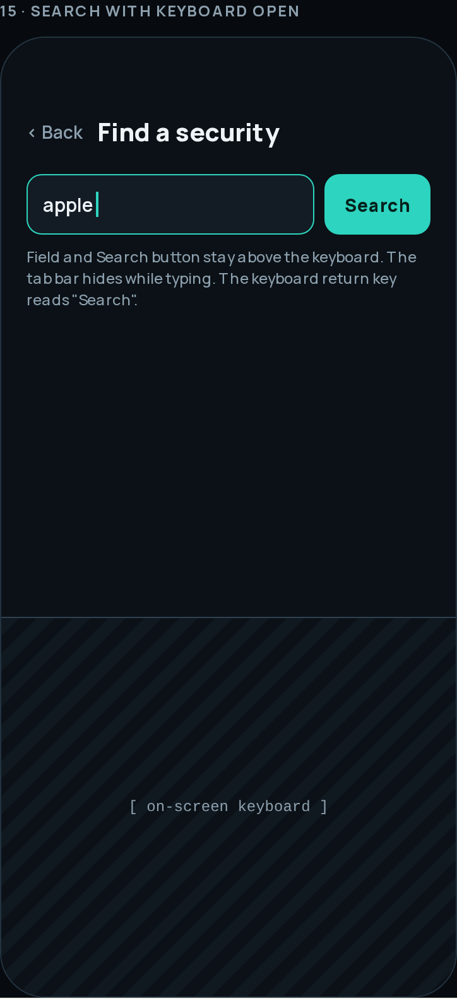

Field and Search button stay above the keyboard; tab bar hides while typing; return key labelled "Search".

### 16 · Narrow phone, 320 × 640
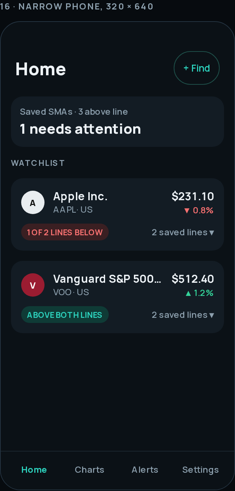

Side padding 14, logos 32, title action shortened to "+ Find", long names truncate with an ellipsis, tags wrap below.

### 17 · iPhone web, in a Safari tab
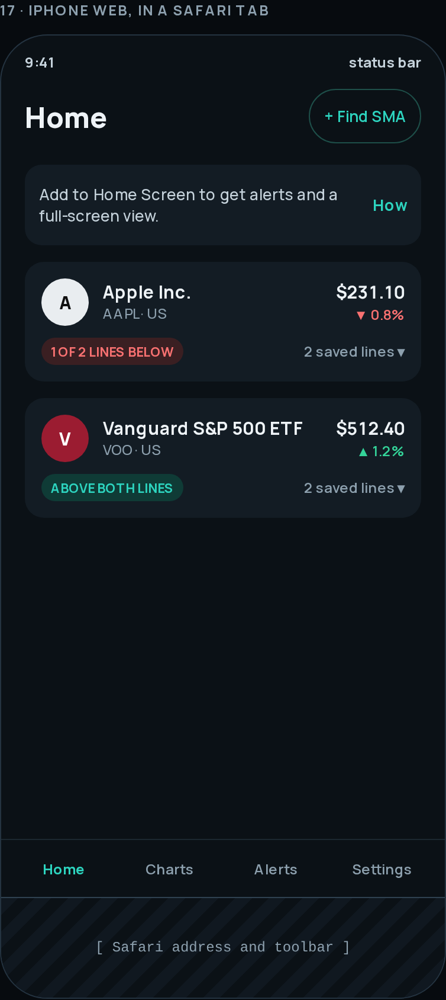

Safari's own toolbar takes space at the bottom. A dismissible tip explains Add to Home Screen. Alerts are unavailable in a tab.

### 18 · iPhone web, opened from the Home Screen
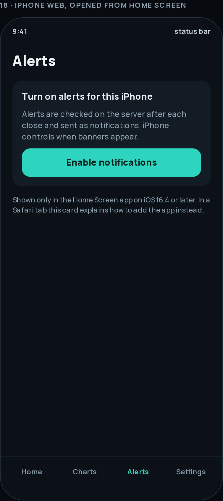

Full-screen (standalone) view with safe-area padding. Alerts tab shows an explicit "Enable notifications" button (iOS 16.4 or later; permission must follow a tap).

## Not designed yet

Light theme · Charts tab landing content · guided example steps · restore-history (unsaved lines) screen · request log screen · notification permission denied · landscape and tablet layouts · real company logos.
